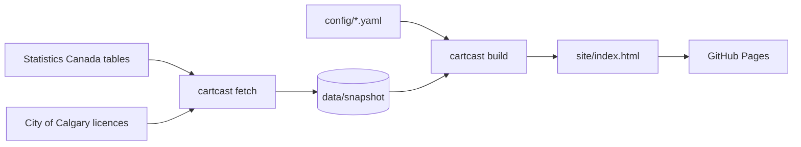

# CartCast YYC

A live dashboard that estimates what a Calgary household spends on groceries each
week, built entirely on public data from Statistics Canada and the City of Calgary.

[](https://github.com/AdrianJulve/cartcast-yyc/actions/workflows/ci.yml)
[](https://github.com/AdrianJulve/cartcast-yyc/actions/workflows/refresh-and-deploy.yml)


**[View the live dashboard](https://adrianjulve.github.io/cartcast-yyc/)**


## Overview

Food prices in Canada are forecast to rise 4 to 6 percent in 2026. Statistics
Canada publishes the prices needed to plan a grocery budget, but in a table of
about 110 products across 13 geographies that is not designed for household use.
CartCast turns that table into a single page: pick a household size and a basket,
and see the weekly cost, how it has changed, where to save, and where to shop.

## Highlights

- **Editable basket** priced from monthly Alberta average retail prices and scaled by household size, with a two-year trend and a three-month outlook range.
- **Calgary context**: grocery inflation from the Calgary CPI, and a comparison with the Market Basket Measure food cost for Calgary.
- **Substitutions** that show the weekly saving and apply to the basket in one click.
- **Store map** of licensed food retailers on OpenStreetMap. Select a store or any spot to see what is within walking distance and how far the nearest supermarket is.
- **Cross-filtering** by month, aisle, product, community or store type across every chart, card and table.
- **Shareable views**, with the basket and filters stored in the URL, plus light and dark themes.
- **Automated refresh**: a weekly GitHub Actions job downloads new data, commits a snapshot and redeploys the site.

## Data

| Source | Used for |
|---|---|
| [StatCan 18-10-0245-01](https://www150.statcan.gc.ca/t1/tbl1/en/tv.action?pid=1810024501), average retail prices | Basket cost, price changes, substitutions |
| [StatCan 18-10-0004-01](https://www150.statcan.gc.ca/t1/tbl1/en/tv.action?pid=1810000401), Consumer Price Index | Grocery inflation (Calgary CMA) |
| [StatCan 11-10-0066-01](https://www150.statcan.gc.ca/t1/tbl1/en/tv.action?pid=1110006601), Market Basket Measure | Calgary food benchmark |
| [City of Calgary Business Licences](https://data.calgary.ca/d/vdjc-pybd) | Store map |
| [Canada's Food Price Report 2026](https://www.dal.ca/sites/agri-food/research/canada-s-food-price-report-2026.html) | Outlook range |

Statistics Canada does not publish average prices for individual cities, so item
prices are Alberta averages. Average prices describe price levels, not inflation,
so every inflation figure uses the CPI. See [methodology](docs/methodology.md) and
[data sources](docs/data-sources.md).

## How it works



A Python pipeline (pandas) downloads the sources, classifies business licences
into supermarkets and specialty grocers, and writes a compact snapshot. The build
step renders one self-contained HTML file with the data embedded. The dashboard is
plain JavaScript with hand-built SVG charts and a custom tile map, with no
front-end libraries and no server. Design notes are in
[architecture](docs/architecture.md).

## Run locally

```bash
git clone https://github.com/AdrianJulve/cartcast-yyc.git
cd cartcast-yyc
pip install -e ".[dev]"
python -m cartcast build
python -m cartcast serve    # http://localhost:8000
```

Commands, configuration, deployment and the project layout are covered in
[docs/development.md](docs/development.md).

## Licence

Code is released under the [MIT licence](LICENSE). Data is used under its
publishers' licences, listed in [DATA_LICENSE.md](DATA_LICENSE.md).

Adapted from Statistics Canada. This does not constitute an endorsement by
Statistics Canada of this product.
