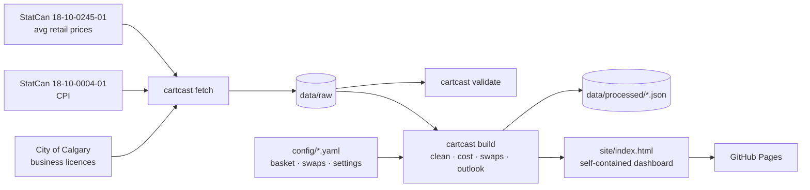

# CartCast YYC 🛒

**Know your grocery bill before you shop.** CartCast YYC prices a Calgary household's
weekly grocery basket every month using Statistics Canada's Alberta average retail
prices. It shows what moved, suggests cheaper swaps for the same meal, and maps
licensed grocery retailers from City of Calgary Open Data.

[](https://github.com/AdrianJulve/cartcast-yyc/actions/workflows/ci.yml)
[](https://github.com/AdrianJulve/cartcast-yyc/actions/workflows/refresh-and-deploy.yml)


<sub>Dashboard built from the offline **sample** dataset. Prices are synthetic, so build with live data before presenting numbers.</sub>

---

## Why

- Canada's Food Price Report 2026 forecasts food prices rising **4–6%** in 2026. It puts the average family of four's food bill at **$17,571.79**, and food is about 27% more expensive than five years ago. Alberta is among the provinces expected to rise faster than the national average.
- Calgary Food Bank demand is at record levels, and a growing share of its clients are working households.
- The data to plan a grocery budget already exists, but it lives in a StatCan table with ~110 products × 13 geographies that nobody browses before shopping.

CartCast turns those tables into one page a household, a community agency or a
funder can act on.

## Features

| | |
|---|---|
| 💵 **Weekly basket cost** | Editable basket of real StatCan products, scaled for household size |
| 📈 **Cost over time + outlook** | 2-year history with a 3-month band based on the Food Price Report's 4–6% range |
| 🔺 **What moved** | 12-month change in average price for every item in the basket |
| 🔁 **Smart swaps** | "Same meal, lower price" pairs with weekly savings. Tap a saving to apply it |
| 🥕 **Aisle breakdown** | Where the grocery dollar goes |
| 📍 **Store map** | Licensed food retailers by community, from City of Calgary business licences |
| 📊 **Inflation context** | CPI "food purchased from stores" for Alberta (and Calgary CMA) |
| 🔗 **Share links** | The basket, household and applied swaps are encoded in the URL. Ideal for the live demo |
| 🧪 **Offline sample mode** | Builds with no internet, which is safe for presenting |
| 🔄 **Monthly auto-refresh** | A GitHub Action fetches new data and redeploys to GitHub Pages |

## Quick start

```bash
git clone https://github.com/AdrianJulve/cartcast-yyc.git
cd cartcast-yyc
python -m venv .venv && source .venv/bin/activate      # Windows: .venv\Scripts\activate
pip install -e ".[dev]"

# Offline, using sample data
python -m cartcast build --sample
python -m cartcast serve                               # → http://localhost:8000

# Live data (the CPI table is a large download; the first fetch takes a few minutes)
python -m cartcast fetch
python -m cartcast validate
python -m cartcast build
```

With `make`: `make demo` (sample build + serve), `make data build`, `make check`.
Run `make help` for every target.

## Commands

| Command | What it does |
|---|---|
| `cartcast fetch [--only prices cpi stores]` | Downloads the source tables into `data/raw/` |
| `cartcast validate [--sample]` | Checks every basket/swap product name against the data and suggests fixes |
| `cartcast build [--sample] [--out DIR]` | Writes `data/processed/*.json` and the self-contained `site/index.html` |
| `cartcast serve [--port 8000]` | Local preview server |

## Data sources

| Dataset | Used for | Refresh |
|---|---|---|
| [StatCan 18-10-0245-01](https://www150.statcan.gc.ca/t1/tbl1/en/tv.action?pid=1810024501): monthly average retail prices, Alberta | Basket cost, movers, swaps, aisles | Monthly |
| [StatCan 18-10-0004-01](https://www150.statcan.gc.ca/t1/tbl1/en/tv.action?pid=1810000401): Consumer Price Index | Grocery inflation KPI | Monthly |
| [City of Calgary Business Licences (`vdjc-pybd`)](https://data.calgary.ca/d/vdjc-pybd) | Store map | Daily (fetched monthly) |
| [Canada's Food Price Report 2026](https://www.dal.ca/sites/agri-food/research/canada-s-food-price-report-2026.html) | Outlook range (4–6%) | Annual |

Full detail, field mappings and caveats: [`docs/data-sources.md`](docs/data-sources.md) ·
licences: [`DATA_LICENSE.md`](DATA_LICENSE.md).

> **Method note.** StatCan advises that average retail prices describe *price levels*
> and shouldn't be used to calculate price change over time. For inflation, use
> the CPI. CartCast labels basket changes as "price change" and uses the CPI for
> every inflation figure. See [`docs/methodology.md`](docs/methodology.md).

## How it works



More in [`docs/architecture.md`](docs/architecture.md).

## Project structure

```
cartcast-yyc/
├── config/                 # basket.yaml · swaps.yaml · settings.yaml  ← edit these
├── src/cartcast/           # pipeline package + CLI
│   ├── sources.py          #   downloads (StatCan zip, Socrata API)
│   ├── prices.py  cpi.py   #   StatCan loaders
│   ├── stores.py           #   licence → grocery store classification
│   ├── basket.py           #   costing, swaps, aisle shares, outlook
│   ├── build.py  cli.py    #   payload + site rendering, commands
│   └── templates/dashboard.html
├── data/
│   ├── sample/             # synthetic offline dataset (committed)
│   ├── raw/                # downloads (git-ignored)
│   └── processed/          # build output (git-ignored)
├── scripts/make_sample_data.py
├── tests/                  # pytest suite
├── design/                 # pitch mockup (PNG + HTML source)
├── docs/                   # data sources, methodology, architecture, presentation plan
└── .github/                # CI, monthly refresh + Pages deploy, templates
```

## Customise

- **Basket:** edit `config/basket.yaml`. Product names must match StatCan exactly; `cartcast validate` suggests corrections.
- **Swaps:** edit `config/swaps.yaml`. `ratio` converts quantities, e.g. 1 kg fresh salmon ≈ 4.7 cans.
- **Geography:** change `geography.prices` in `config/settings.yaml` to any province.
- **Outlook:** `dashboard.outlook_annual_low/high`.

## Deploying

1. Push to GitHub, then go to **Settings → Pages → Source: GitHub Actions**.
2. Run **Actions → Refresh data & deploy dashboard → Run workflow**. Tick *use sample* if you want a demo build.
3. After that it refreshes automatically on the 22nd of each month.

## Presentation

This repo is the live demonstration for a 10-minute DATA 398.1 pitch. The scenario,
run of show, roles, demo script and backup plan are in
[`docs/presentation-plan.md`](docs/presentation-plan.md).

## Contributing

Branch → commit (Conventional Commits) → `make check` → pull request → review. See
[`CONTRIBUTING.md`](CONTRIBUTING.md).

## Licence

Code: [MIT](LICENSE). Data: publishers' open licences, see [`DATA_LICENSE.md`](DATA_LICENSE.md).
*Adapted from Statistics Canada. This does not constitute an endorsement by Statistics
Canada of this product.*
