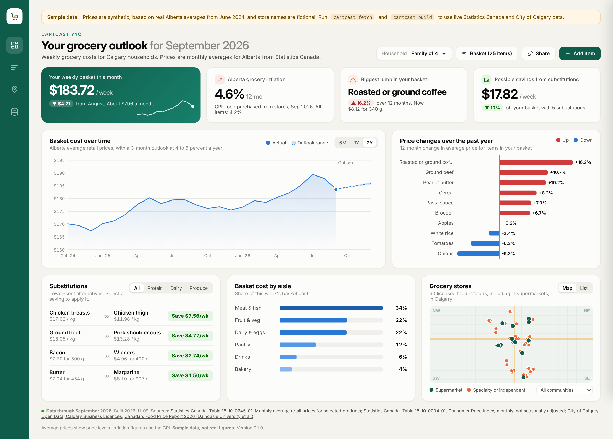
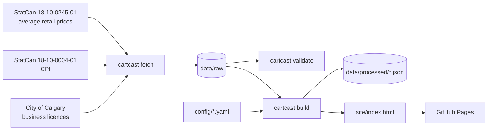

# CartCast YYC

CartCast YYC is a dashboard that estimates what a Calgary household spends on
groceries each week. It prices a basket of common items using Statistics Canada's
monthly average retail prices for Alberta, shows which items changed most in the
past year, suggests cheaper substitutes, and maps licensed grocery retailers using
City of Calgary Open Data.

[](https://github.com/AdrianJulve/cartcast-yyc/actions/workflows/ci.yml)
[](https://github.com/AdrianJulve/cartcast-yyc/actions/workflows/refresh-and-deploy.yml)




The screenshot uses the offline sample dataset, so the prices shown are synthetic.

## Background

Canada's Food Price Report 2026 forecasts that food prices will rise 4 to 6 percent
in 2026. It estimates that an average family of four will spend $17,571.79 on food
this year, and that food prices are 27 percent higher than five years ago. Alberta
is one of the provinces expected to see increases above the national average.
Demand at the Calgary Food Bank is at record levels.

Statistics Canada already publishes the prices needed to plan a grocery budget, but
the table covers about 110 products across 13 geographies and is not designed for
household use. CartCast presents the same data as a single page.

## Features

- Weekly basket cost for an editable list of StatCan products, scaled by household size.
- Basket cost over the past two years, with a three-month outlook range.
- Twelve-month change in average price for each item in the basket.
- Substitution suggestions with the weekly saving for each. Selecting one applies it to the basket.
- Share of the basket cost by aisle.
- Map and list of licensed food retailers, filterable by community.
- Grocery inflation from the Consumer Price Index for Alberta and the Calgary CMA.
- Shareable links. The basket, household size and applied substitutions are stored in the URL.
- An offline sample mode for working without an internet connection.
- A monthly GitHub Actions job that downloads new data and redeploys the site to GitHub Pages.

## Getting started

```bash
git clone https://github.com/AdrianJulve/cartcast-yyc.git
cd cartcast-yyc
python -m venv .venv
source .venv/bin/activate          # Windows: .venv\Scripts\Activate.ps1
pip install -e ".[dev]"
```

Build and preview with the sample data:

```bash
python -m cartcast build --sample
python -m cartcast serve           # http://localhost:8000
```

Build with live data. The CPI table is a large download, so the first fetch takes a
few minutes.

```bash
python -m cartcast fetch
python -m cartcast validate
python -m cartcast build
```

If `make` is installed, `make help` lists shortcuts such as `make demo`,
`make data build` and `make check`.

## Commands

| Command | Description |
|---|---|
| `cartcast fetch [--only prices cpi stores]` | Download the source tables into `data/raw/` |
| `cartcast validate [--sample]` | Check basket and substitution product names against the data |
| `cartcast build [--sample] [--out DIR]` | Write `data/processed/*.json` and `site/index.html` |
| `cartcast serve [--port 8000]` | Serve the built site locally |

## Data sources

| Dataset | Used for | Updated |
|---|---|---|
| [StatCan Table 18-10-0245-01](https://www150.statcan.gc.ca/t1/tbl1/en/tv.action?pid=1810024501), monthly average retail prices (Alberta) | Basket cost, price changes, substitutions, aisle shares | Monthly |
| [StatCan Table 18-10-0004-01](https://www150.statcan.gc.ca/t1/tbl1/en/tv.action?pid=1810000401), Consumer Price Index | Grocery inflation figure | Monthly |
| [City of Calgary Business Licences](https://data.calgary.ca/d/vdjc-pybd) (`vdjc-pybd`) | Store map | Daily (fetched monthly) |
| [Canada's Food Price Report 2026](https://www.dal.ca/sites/agri-food/research/canada-s-food-price-report-2026.html) | Outlook range | Annually |

Field mappings and known issues are documented in
[docs/data-sources.md](docs/data-sources.md). Licences are listed in
[DATA_LICENSE.md](DATA_LICENSE.md).

Statistics Canada advises that average retail prices describe price levels in a
given month and should not be used to measure price change over time. CartCast
labels item-level changes as "change in average price" and uses the CPI for all
inflation figures. See [docs/methodology.md](docs/methodology.md).

## How it works



The build step produces one HTML file with the data embedded in it. It has no
server or external dependencies. Details are in
[docs/architecture.md](docs/architecture.md).

## Project structure

```
cartcast-yyc/
├── config/                 basket.yaml, swaps.yaml, settings.yaml
├── src/cartcast/           pipeline package and CLI
│   ├── sources.py          downloads (StatCan zip files, Socrata API)
│   ├── prices.py, cpi.py   StatCan table loaders
│   ├── stores.py           business licence classification
│   ├── basket.py           basket cost, substitutions, aisle shares, outlook
│   ├── build.py, cli.py    site rendering and commands
│   └── templates/dashboard.html
├── data/
│   ├── sample/             synthetic offline dataset (committed)
│   ├── raw/                downloaded files (ignored by git)
│   └── processed/          build output (ignored by git)
├── scripts/make_sample_data.py
├── tests/
├── design/                 dashboard mockup (PNG and HTML)
├── docs/
└── .github/                workflows, issue and pull request templates
```

## Configuration

- Basket: `config/basket.yaml`. Product names must match StatCan exactly. Run `cartcast validate` to check them.
- Substitutions: `config/swaps.yaml`. The `ratio` field converts between package sizes. For example, 1 kg of fresh salmon is about 4.7 cans of 213 g.
- Geography: `geography.prices` in `config/settings.yaml` accepts any province.
- Outlook range: `dashboard.outlook_annual_low` and `dashboard.outlook_annual_high`.

## Deployment

1. Push the repository to GitHub.
2. In the repository settings, open Pages and set the source to GitHub Actions.
3. Run the "Refresh data and deploy dashboard" workflow from the Actions tab. Select `use_sample` for a build that does not depend on the live sources.

The workflow then runs automatically on the 22nd of each month.

## Presentation

This project is the live demonstration for a 10-minute DATA 398.1 presentation.
The scenario, schedule, roles, demo steps and fallback plan are in
[docs/presentation-plan.md](docs/presentation-plan.md).

## Contributing

See [CONTRIBUTING.md](CONTRIBUTING.md).

## Licence

The code is released under the [MIT licence](LICENSE). The data is covered by its
publishers' licences, listed in [DATA_LICENSE.md](DATA_LICENSE.md).

Adapted from Statistics Canada. This does not constitute an endorsement by
Statistics Canada of this product.
