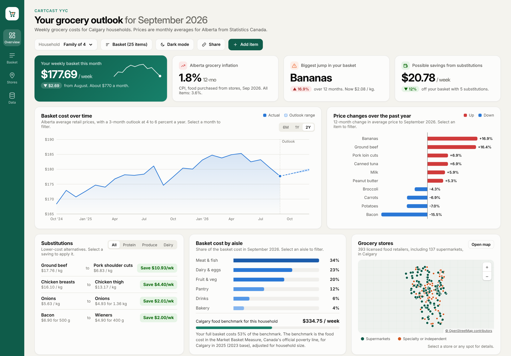
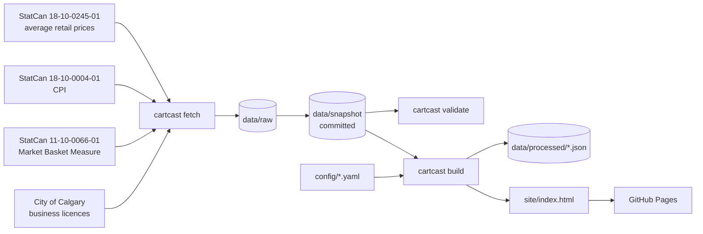

# CartCast YYC

CartCast YYC is a dashboard that estimates what a Calgary household spends on
groceries each week. It prices a basket of common items using Statistics Canada's
monthly average retail prices for Alberta, compares the result with the official
food cost for Calgary from the Market Basket Measure, reports grocery inflation for
the Calgary CMA, suggests cheaper substitutes, and maps licensed grocery retailers
using City of Calgary Open Data.

[](https://github.com/AdrianJulve/cartcast-yyc/actions/workflows/ci.yml)
[](https://github.com/AdrianJulve/cartcast-yyc/actions/workflows/refresh-and-deploy.yml)


Live dashboard: <https://adrianjulve.github.io/cartcast-yyc/>



## Background

Canada's Food Price Report 2026 forecasts that food prices will rise 4 to 6 percent
in 2026. It estimates that an average family of four will spend $17,571.79 on food
this year, and that food prices are 27 percent higher than five years ago. Alberta
is one of the provinces expected to see increases above the national average.
Demand at the Calgary Food Bank is at record levels.

Statistics Canada already publishes the prices needed to plan a grocery budget, but
the table covers about 110 products across 13 geographies and is not designed for
household use. CartCast presents the same data as a single page.

## Features

- Weekly basket cost for an editable list of StatCan products, scaled by household size.
- Basket cost over the past two years, with a three-month outlook range.
- Twelve-month change in average price for each item in the basket.
- Substitution suggestions with the weekly saving for each. Selecting one applies it to the basket.
- Share of the basket cost by aisle.
- Map of licensed food retailers on an OpenStreetMap base map, with zoom, panning and a searchable list.
- Store details: selecting a store shows its type, licence, what it likely sells, stores within 1 km and 2 km, the nearest supermarket, the nearest stores and a directions link, with distance rings on the map.
- Food access check: selecting any spot on the map shows how many food retailers are within 1 km and 2 km and how far the nearest supermarket is, with walking time.
- Community summary: filtering to a community outlines it on the map and shows its store counts and its rank among communities.
- One-click Clear basket and Restore default basket, each with Undo.
- Cross-filtering: selecting a month, aisle, product, community or store type filters every related chart, card and table. A filter bar shows what is active, and Esc clears it.
- Four pages: Overview, Basket (a sortable, editable table), Stores (a full-size map and list) and Data (sources, freshness and methods).
- Grocery inflation for the Calgary CMA from the Consumer Price Index, with Alberta as a fallback.
- A Calgary food benchmark: the Market Basket Measure food cost for Calgary, adjusted for household size, compared with the basket.
- Shareable links. The basket, household size and applied substitutions are stored in the URL.
- A committed snapshot of the real data in `data/snapshot/`, so the dashboard can be rebuilt without downloading anything.
- A synthetic sample dataset for tests and offline development.
- A live site on GitHub Pages. A GitHub Actions job checks for new data every week, commits it, and redeploys.

## Getting started

```bash
git clone https://github.com/AdrianJulve/cartcast-yyc.git
cd cartcast-yyc
python -m venv .venv
source .venv/bin/activate          # Windows: .venv\Scripts\Activate.ps1
pip install -e ".[dev]"
```

Download the real data, then build and preview the dashboard. The CPI table is a
large download, so the first fetch takes a few minutes.

```bash
python -m cartcast fetch           # downloads to data/raw/ and updates data/snapshot/
python -m cartcast validate
python -m cartcast build
python -m cartcast serve           # http://localhost:8000
```

Commit `data/snapshot/` after a fetch so teammates and GitHub Actions can build
from the same real data. Once a snapshot is committed, `cartcast build` works
without downloading anything.

To work with the synthetic sample data instead, add `--sample` to `build` and
`validate`.

If `make` is installed, `make help` lists shortcuts such as `make demo`,
`make data build` and `make check`.

## Commands

| Command | Description |
|---|---|
| `cartcast fetch [--only prices cpi mbm stores]` | Download the sources into `data/raw/` and update `data/snapshot/` |
| `cartcast snapshot` | Rebuild `data/snapshot/` from files already in `data/raw/` |
| `cartcast validate [--sample]` | Check basket and substitution product names against the data |
| `cartcast build [--sample] [--out DIR]` | Build from the snapshot (or sample data) into `data/processed/` and `site/index.html` |
| `cartcast serve [--port 8000]` | Serve the built site locally |

## Data sources

| Dataset | Used for | Updated |
|---|---|---|
| [StatCan Table 18-10-0245-01](https://www150.statcan.gc.ca/t1/tbl1/en/tv.action?pid=1810024501), monthly average retail prices (Alberta) | Basket cost, price changes, substitutions, aisle shares | Monthly |
| [StatCan Table 18-10-0004-01](https://www150.statcan.gc.ca/t1/tbl1/en/tv.action?pid=1810000401), Consumer Price Index (Calgary CMA and Alberta) | Grocery inflation figure | Monthly |
| [StatCan Table 11-10-0066-01](https://www150.statcan.gc.ca/t1/tbl1/en/tv.action?pid=1110006601), Market Basket Measure thresholds (Calgary) | Calgary food benchmark | Annually |
| [City of Calgary Business Licences](https://data.calgary.ca/d/vdjc-pybd) (`vdjc-pybd`) | Store map | Daily (fetched monthly) |
| [Canada's Food Price Report 2026](https://www.dal.ca/sites/agri-food/research/canada-s-food-price-report-2026.html) | Outlook range | Annually |

Statistics Canada does not publish average retail prices for individual cities, so
item prices are Alberta averages. The inflation figure, the food benchmark and the
store map are specific to Calgary.

Field mappings and known issues are documented in
[docs/data-sources.md](docs/data-sources.md). Licences are listed in
[DATA_LICENSE.md](DATA_LICENSE.md).

Statistics Canada advises that average retail prices describe price levels in a
given month and should not be used to measure price change over time. CartCast
labels item-level changes as "change in average price" and uses the CPI for all
inflation figures. See [docs/methodology.md](docs/methodology.md).

## How it works



The build step produces one HTML file with the data embedded in it. It needs no
server. The only external requests are the base map tiles, and the map falls back
to a plain grid if they cannot load. Details are in
[docs/architecture.md](docs/architecture.md).

## Project structure

```
cartcast-yyc/
├── config/                 basket.yaml, swaps.yaml, settings.yaml
├── src/cartcast/           pipeline package and CLI
│   ├── sources.py          downloads (StatCan zip files, Socrata API)
│   ├── prices.py, cpi.py   StatCan table loaders
│   ├── mbm.py              Market Basket Measure food threshold
│   ├── snapshot.py         compact real-data extracts
│   ├── stores.py           business licence classification
│   ├── basket.py           basket cost, substitutions, aisle shares, outlook
│   ├── build.py, cli.py    site rendering and commands
│   └── templates/dashboard.html
├── data/
│   ├── snapshot/           real data used by the dashboard (committed)
│   ├── sample/             synthetic dataset for tests (committed)
│   ├── raw/                downloaded files (ignored by git)
│   └── processed/          build output (ignored by git)
├── scripts/make_sample_data.py
├── tests/
├── design/                 dashboard mockup (PNG and HTML)
├── docs/
└── .github/                workflows, issue and pull request templates
```

## Configuration

- Basket: `config/basket.yaml`. Product names must match StatCan exactly. Run `cartcast validate` to check them.
- Substitutions: `config/swaps.yaml`. The `ratio` field converts between package sizes. For example, 1 kg of fresh salmon is about 4.7 cans of 213 g.
- Geography: `geography.prices` in `config/settings.yaml` accepts any province.
- Outlook range: `dashboard.outlook_annual_low` and `dashboard.outlook_annual_high`.

## Deployment

1. Push the repository to GitHub.
2. In the repository settings, open Pages and set the source to GitHub Actions.
3. Run the "Refresh data and deploy dashboard" workflow from the Actions tab, or push a commit to `main`. The first run downloads the real data, commits `data/snapshot/` and publishes the site.

After that, the workflow runs every Monday to pick up new data, and every push to
`main` redeploys the site. The dashboard footer shows when the data was last
downloaded.

## Presentation

This project is the live demonstration for a 10-minute DATA 398.1 presentation.
The scenario, schedule, roles, demo steps and fallback plan are in
[docs/presentation-plan.md](docs/presentation-plan.md).

## Contributing

See [CONTRIBUTING.md](CONTRIBUTING.md).

## Licence

The code is released under the [MIT licence](LICENSE). The data is covered by its
publishers' licences, listed in [DATA_LICENSE.md](DATA_LICENSE.md).

Adapted from Statistics Canada. This does not constitute an endorsement by
Statistics Canada of this product.
