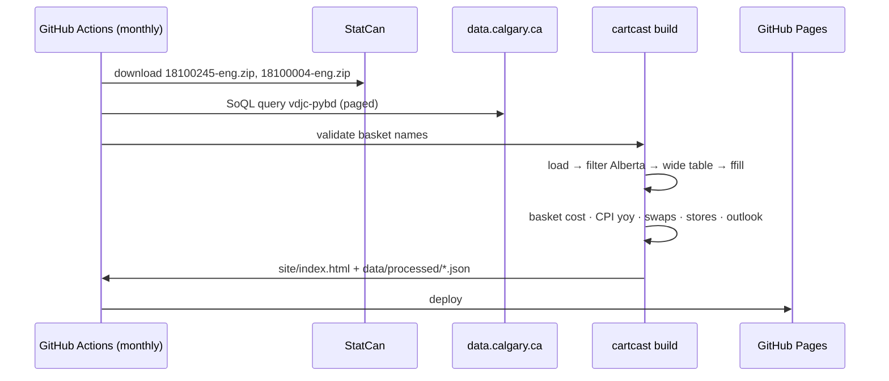

# Architecture

CartCast is deliberately simple: a Python pipeline produces **one self-contained
HTML file** with the data embedded. No server, database or API keys. It can be
hosted free on GitHub Pages, emailed, or opened from a USB stick during the
presentation.

## Modules

| Module | Responsibility |
|---|---|
| `config.py` | Reads `config/*.yaml` into typed objects (`BasketItem`, `Swap`, `Config`) |
| `sources.py` | HTTP with retries. StatCan zip extraction and Socrata paging, standard library only |
| `prices.py` | Loads 18-10-0245-01, filters geography, reshapes, computes yoy, fuzzy name suggestions |
| `cpi.py` | Streams 18-10-0004-01 in chunks, filters, computes 12-month change |
| `stores.py` | Classifies licence records into supermarket / specialty, dedupes |
| `basket.py` | Basket cost, aisle shares, swap savings, outlook band, validation |
| `build.py` | Assembles the JSON payload and injects it into the HTML template |
| `cli.py` | `fetch`, `validate`, `build`, `serve` |

## The dashboard (`templates/dashboard.html`)

- Vanilla JS and inline SVG, with no external libraries or network calls, so it works offline.
- Python precomputes 36 months of prices for all ~110 products. The browser recomputes the basket, swaps and charts instantly when the user edits anything.
- State (household, items, applied swaps) lives in the URL hash (`#b=…`), so a basket can be shared or turned into a QR code.
- The data is embedded as `<script type="application/json">`, with `</` escaped so data can't break out of the tag.
- It's accessible: real `<select>`/`<button>` controls, `aria-pressed` toggles, keyboard focus styles, tooltips on hover, and every value labelled as text (never colour alone).

## Design system

Colours, spacing and chart conventions match `design/mockup.html`: a brand green
`#0f5c4a` with an orange accent, a single-hue blue for magnitude, blue/red for
up/down, thin marks, 4 px rounded bar ends, recessive gridlines, and Inter type.
