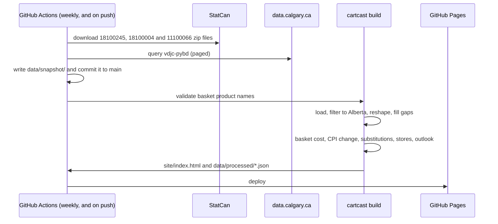

# Architecture

The Python pipeline produces a single HTML file with the data embedded in it. The
site needs no server, database or API keys. It can be hosted on GitHub Pages or
opened directly from a local copy. The only external requests are base map tiles
for the store map; without a connection the map shows a plain grid and every other
part of the dashboard still works.

## Modules

| Module | Purpose |
|---|---|
| `config.py` | Reads `config/*.yaml` into `BasketItem`, `Swap` and `Config` objects |
| `sources.py` | Downloads files with retries: StatCan zip extraction and Socrata paging. Uses only the standard library |
| `prices.py` | Loads Table 18-10-0245-01, filters by geography, reshapes, calculates 12-month change, suggests names |
| `cpi.py` | Reads Table 18-10-0004-01 in chunks, filters it and calculates 12-month change |
| `mbm.py` | Loads the Calgary Market Basket Measure food threshold and calculates the weekly benchmark |
| `snapshot.py` | Writes the compact real-data extracts in `data/snapshot/` and the manifest |
| `stores.py` | Classifies licence records as supermarket or specialty and removes duplicates |
| `basket.py` | Basket cost, aisle shares, substitution savings, outlook range and name validation |
| `build.py` | Builds the data payload and inserts it into the HTML template |
| `cli.py` | The `fetch`, `snapshot`, `validate`, `build` and `serve` commands |

## Dashboard (`templates/dashboard.html`)

- Written in plain JavaScript with inline SVG charts and no external libraries.
- The store map draws CARTO basemap tiles (OpenStreetMap data) in Web Mercator, with its own zoom and drag handling. The tile address and attribution are set in `config/settings.yaml` under `dashboard.map`.
- Four pages share one state: Overview, Basket, Stores and Data. The sidebar switches between them.
- Cross-filtering: one filter state (month, aisle, product, community, store type) drives every visual. Selecting the same element again, the chip in the filter bar, or Esc clears a filter. Store relevance to an aisle comes from trade-name keywords: supermarkets and general grocers match every aisle; butchers, produce stores and bakeries match their own.
- Python includes 36 months of prices for all of the roughly 110 products. The browser recalculates the basket, substitutions and charts whenever the user changes something.
- The household size, basket items, applied substitutions, current page and filters are stored in the URL after `#b=`, so a view can be shared as a link or a QR code.
- The data is embedded in a `<script type="application/json">` element. Any `</` in the data is escaped so it cannot close the element early.
- Controls are standard `<select>` and `<button>` elements with `aria-pressed` states and visible keyboard focus. Every value is shown as text, so no information depends on colour alone.

## Visual design

Colours, spacing and chart styles follow `design/mockup.html`: a dark green brand
colour (`#0f5c4a`) with an orange accent, shades of blue for magnitude, blue and
red for decreases and increases, thin marks, bars with 4 px rounded ends, light
gridlines, and the Inter typeface.
